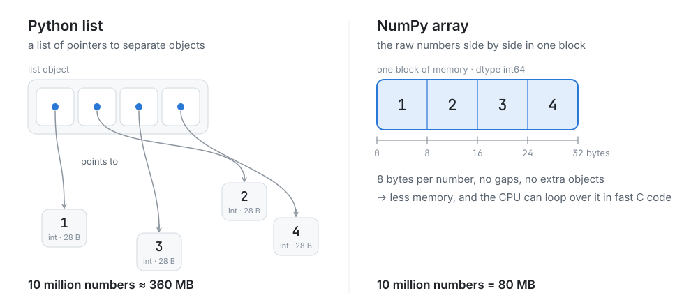
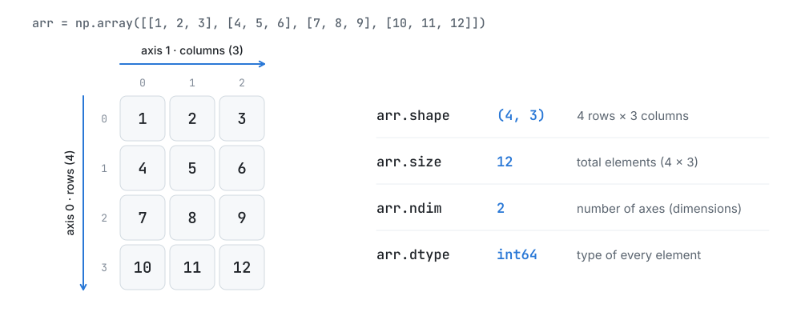
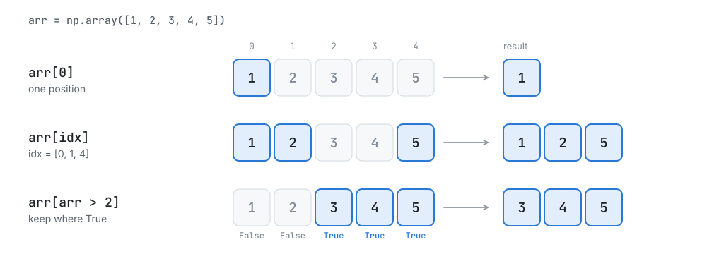
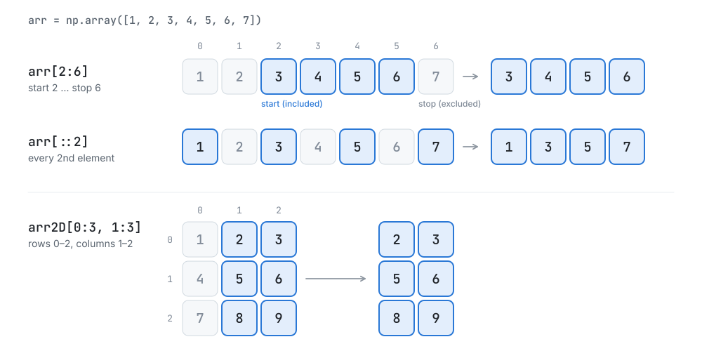
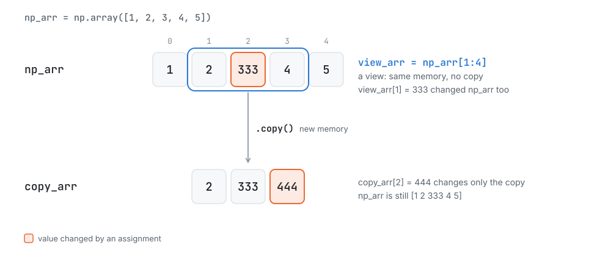
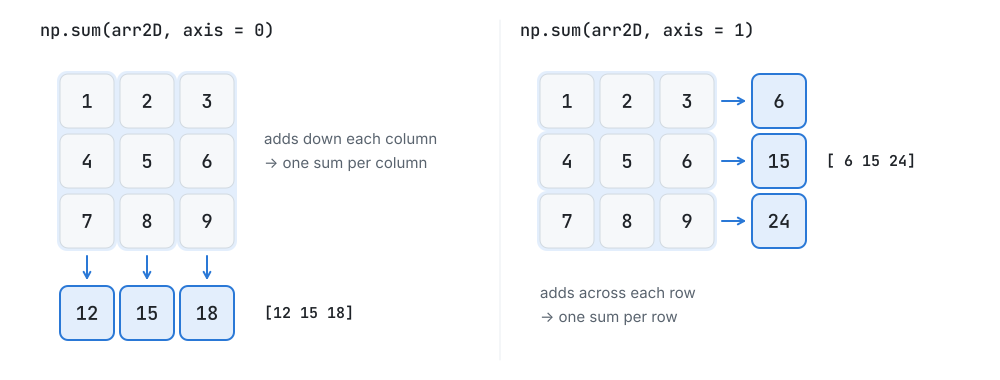
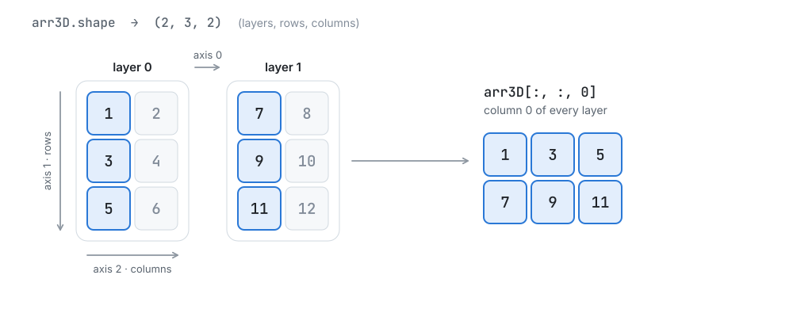
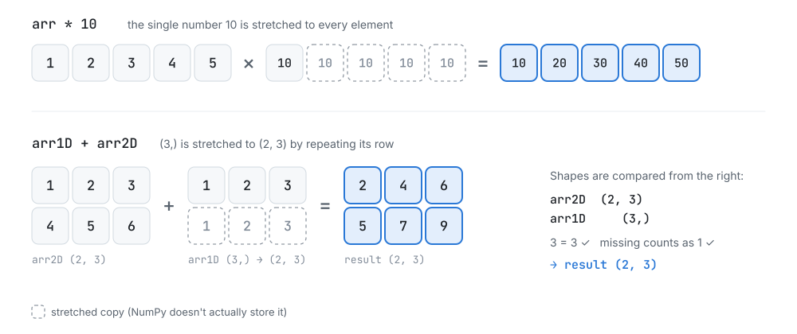

<p align="center">
  
</p>

<h1 align="center">NumPy Tutorial for Beginners</h1>

<p align="center">
  Learn NumPy from zero. Each topic is explained in plain English, with the code from
  <a href="numpy_tutorial.ipynb"><code>numpy_tutorial.ipynb</code></a>, its real output, and diagrams where they help.
</p>

<p align="center">
  
  
  
</p>

---

## Contents

| The basics | Working with arrays | Going further |
|---|---|---|
| [What is NumPy?](#what-is-numpy) | [5. Indexing](#5-indexing) | [9. Data Types](#9-data-types) |
| [1. Lists vs Arrays](#1-python-lists-vs-numpy-arrays) | [6. Slicing](#6-slicing) | [10. Vectorization & Broadcasting](#10-vectorization-and-broadcasting) |
| [2. Creating Arrays](#2-creating-arrays) | [7. Copy vs View](#7-copy-vs-view) | [11. Math Functions](#11-mathematical-functions) |
| [3. Array Properties](#3-array-properties) | [8. Axes (2D & 3D)](#8-axes-in-multi-dimensional-arrays) | [Run It Yourself](#run-it-yourself) |
| [4. Reshaping](#4-reshaping) | | |

---

## What is NumPy?

**NumPy** (short for *Numerical Python*) is the open-source library Python uses for fast work with numbers. Its core is the **`ndarray`** (n-dimensional array): a grid of values that all share one data type and sit side by side in memory. That design lets NumPy do math on a whole array at once in optimized C code. It's why pandas, Matplotlib and scikit-learn are built on top of NumPy, and why deep-learning libraries like TensorFlow and PyTorch work closely with it.

```bash
pip install numpy
```

```python
import numpy as np
```

`np` is the short name everyone uses for NumPy.

---

## 1. Python Lists vs NumPy Arrays

A Python list can hold anything, so it stores **pointers** to separate Python objects scattered around memory. A NumPy array stores the **raw numbers themselves**, all of the same type, in one continuous block. That makes arrays smaller, and lets NumPy loop over them in C instead of Python.

<picture>
  <source media="(prefers-color-scheme: dark)" srcset="images/list-vs-array-dark.svg">
  
</picture>

**Speed:** squaring 10 million numbers with a list, then with an array.

```python
import numpy as np
import time

# NumPy Arrays vs Python Lists - Execution time comparison

# large dataset
size = 10_000_000  # 10 million numbers

# Python Lists
python_list = list(range(size))

start = time.time()
list_squared = [x**2 for x in python_list]  # square of all nums
end = time.time()
print("Python list time:", end - start, "seconds")

# NumPy Arrays
numpy_array = np.array(python_list)
start = time.time()
array_squared = numpy_array ** 2  # vectorized operation
end = time.time()
print("NumPy array time:", end - start, "seconds")
```

In test runs, the list took about **0.6 seconds** and the NumPy array about **0.03 seconds**: roughly **20–30× faster**. Your exact times depend on your computer. `numpy_array ** 2` is a *vectorized* operation: one line squares every element, with no Python loop (more in [section 10](#10-vectorization-and-broadcasting)).

**Memory:** `sys.getsizeof()` only measures the list's own pointers, so the size of every number object has to be added:

```python
# Memory Usage comparison
import sys
list_size = sys.getsizeof(python_list) + sum(sys.getsizeof(x) for x in python_list)
print("Python list size:", list_size)
print("NumPy array size:", numpy_array.nbytes)
```

```text
Python list size: 360000056
NumPy array size: 80000000
```

The list needs about **360 MB** (8 bytes per pointer plus a 28-byte object per number). The array needs **80 MB** (8 bytes per number), which is **4.5× less**.

---

## 2. Creating Arrays

### From Python lists

```python
# Creating NumPy Arrays - from lists
arr = np.array([1, 2, 3, 4])
print(arr, type(arr))

arr2 = np.array([1, 2, 3, 4, "prime"])
print(arr2, type(arr2))

# 2D Arrays - Matrix
arr3 = np.array([[1, 2, 3], [4, 5, 6]])
print(arr3, arr3.shape)
```

```text
[1 2 3 4] <class 'numpy.ndarray'>
['1' '2' '3' '4' 'prime'] <class 'numpy.ndarray'>
[[1 2 3]
 [4 5 6]] (2, 3)
```

- Every element of an array has the **same type**. Mixing numbers with a string turns all of them into strings (dtype `<U21`).
- A list of lists becomes a **2D array** (a matrix): here 2 rows × 3 columns, so its shape is `(2, 3)`.

### From scratch

```python
# Creating NumPy Arrays - from scratch
arr1 = np.zeros((3, 4)) #pre-filled with 0's
print(arr1, arr1.shape)

arr2 = np.ones((3, 3)) #pre-filled with 1's
print(arr2, arr2.shape)

arr3 = np.full((2, 3), 5) #pre-filled with a num
print(arr3, arr3.shape)

arr4 = np.eye(3) #identity matrix
print(arr4)

arr5 = np.arange(1, 20, 2) #elements in range
print(arr5)

arr6 = np.linspace(0, 10, 5) #evenly spaced array
print(arr6)
```

```text
[[0. 0. 0. 0.]
 [0. 0. 0. 0.]
 [0. 0. 0. 0.]] (3, 4)
[[1. 1. 1.]
 [1. 1. 1.]
 [1. 1. 1.]] (3, 3)
[[5 5 5]
 [5 5 5]] (2, 3)
[[1. 0. 0.]
 [0. 1. 0.]
 [0. 0. 1.]]
[ 1  3  5  7  9 11 13 15 17 19]
[ 0.   2.5  5.   7.5 10. ]
```

| Function | Creates |
|---|---|
| `np.zeros(shape)` / `np.ones(shape)` | an array of `0.` / `1.` (decimals by default) |
| `np.full(shape, value)` | an array filled with `value` |
| `np.eye(n)` | an `n × n` identity matrix (1s on the diagonal) |
| `np.arange(start, stop, step)` | numbers from `start` up to, but **not including**, `stop` |
| `np.linspace(start, stop, num)` | `num` evenly spaced numbers, **including** `stop` |

---

## 3. Array Properties

<picture>
  <source media="(prefers-color-scheme: dark)" srcset="images/array-anatomy-dark.svg">
  
</picture>

```python
# Array Properties
arr = np.array([[1, 2, 3], [4, 5, 6], [7, 8, 9], [10, 11, 12]])

print(arr.shape) #dimensions - (m x n)
print(arr.size) #total elements - m*n
print(arr.ndim) #dimension
print(arr.dtype) #data type object
```

```text
(4, 3)
12
2
int64
```

You can choose the type when you create an array (`dtype=`), or convert an existing array with `.astype()`:

```python
str_arr = np.array([1, 2, 3], dtype="U")
print(str_arr, str_arr.dtype)

float_arr = np.array([1, 2, 3], dtype="float64")
print(float_arr, float_arr.dtype)

int_arr = float_arr.astype(np.int64)
print(int_arr, int_arr.dtype)
```

```text
['1' '2' '3'] <U1
[1. 2. 3.] float64
[1 2 3] int64
```

`<U1` means "Unicode text, up to 1 character". `.astype()` returns a **new** array and leaves the original unchanged.

---

## 4. Reshaping

```python
# Reshaping
arr = np.array([1, 2, 3, 4, 5, 6])
print(arr.shape)

reshaped = arr.reshape((2, 3))
print(reshaped, reshaped.shape)

flattened = reshaped.flatten() #converts 2D => 1D
print(flattened, flattened.shape)
```

```text
(6,)
[[1 2 3]
 [4 5 6]] (2, 3)
[1 2 3 4 5 6] (6,)
```

- `reshape((2, 3))` lays the 6 values out row by row into 2 rows × 3 columns. The new shape must hold exactly the same number of elements (2 × 3 = 6).
- `flatten()` turns any array back into 1D, and always returns a copy.
- `(6,)` is how NumPy writes the shape of a 1D array with 6 elements.

---

## 5. Indexing

<picture>
  <source media="(prefers-color-scheme: dark)" srcset="images/indexing-dark.svg">
   2] keeps the positions where the condition is True and gives [3 4 5].">
</picture>

Indexes start at **0**. In a 2D array, the first index picks the row and the second picks the column.

```python
# Indexing
arr = np.array([1, 2, 3, 4, 5]) #1D array
print(arr[0])

arr = np.array([[1, 2, 3], [4, 5, 6], [7, 8, 9], [10, 11, 12]]) #2D array
print(arr[0][1]) #2
print(arr[1][2]) #6
```

```text
1
2
6
```

`arr[0][1]` and the more common NumPy style `arr[0, 1]` give the same element.

**Fancy indexing** picks several positions at once using a list of indexes. **Boolean indexing** keeps only the elements where a condition is `True`:

```python
#Fancy indexing
arr = np.array([1, 2, 3, 4, 5])
idx = [0, 1, 4]
print(arr[idx])

#Boolean indexing
print(arr[arr > 2]) #nums greater than 2
print(arr[arr % 2 == 0]) #even nums
```

```text
[1 2 5]
[3 4 5]
[2 4]
```

On its own, `arr > 2` gives `[False False  True  True  True]`. Putting it inside `[ ]` keeps only the `True` positions.

---

## 6. Slicing

<picture>
  <source media="(prefers-color-scheme: dark)" srcset="images/slicing-dark.svg">
  
</picture>

A slice is written `start:stop:step`. **`start` is included and `stop` is excluded.** A missing `start` means "from the beginning", a missing `stop` means "to the end", and `step` jumps over elements.

```python
# Slicing
arr = np.array([1, 2, 3, 4, 5, 6, 7])

print(arr[2:6]) #[3, 4, 5, 6]
print(arr[:6]) #[1, 2, 3, 4, 5, 6]
print(arr[3:]) #[4, 5, 6, 7]
print(arr[::2]) #[1, 3, 5, 7]
```

```text
[3 4 5 6]
[1 2 3 4 5 6]
[4 5 6 7]
[1 3 5 7]
```

In 2D, give one slice per axis, separated by a comma (rows first, then columns):

```python
arr2D = np.array([[1, 2, 3], [4, 5, 6], [7, 8, 9]])
print(arr2D[0:3, 1:3]) #row(0, 1, 2) & col(1, 2)
```

```text
[[2 3]
 [5 6]
 [8 9]]
```

---

## 7. Copy vs View

<picture>
  <source media="(prefers-color-scheme: dark)" srcset="images/copy-vs-view-dark.svg">
  
</picture>

Slicing a Python list makes a **copy**. Slicing a NumPy array makes a **view**: a window onto the same memory. Views are fast and save memory, but changing a view also changes the original array. Use `.copy()` when you need an independent array.

```python
# Copy vs View by Slicing
#Sliced list is a copy
py_list = [1, 2, 3, 4, 5]
copy_list = py_list[1:4] #[2, 3, 4]
copy_list[1] = 333

print(copy_list)
print(py_list)

#Sliced array is a view
np_arr = np.array([1, 2, 3, 4, 5])
view_arr = np_arr[1:4] #[2, 3, 4]
view_arr[1] = 333

print(view_arr)
print(np_arr)

#Creating a copy
copy_arr = np_arr[1:4].copy() #[2, 333, 4]
copy_arr[2] = 444
print(copy_arr)
print(np_arr)
```

```text
[2, 333, 4]
[1, 2, 3, 4, 5]
[  2 333   4]
[  1   2 333   4   5]
[  2 333 444]
[  1   2 333   4   5]
```

The list stays `[1, 2, 3, 4, 5]`, but `np_arr` changes to `[1 2 333 4 5]` through the view. The copy's `444` never reaches `np_arr`.

---

## 8. Axes in Multi-dimensional Arrays

Each dimension of an array is called an **axis**:

- a 1D array has 1 axis (`axis 0`)
- a 2D array has 2 axes: `axis 0` = rows, `axis 1` = columns
- a 3D array has 3 axes: `axis 0` = layers, `axis 1` = rows in each layer, `axis 2` = columns in each layer

Many functions take an `axis` argument that decides which direction they work along.

<picture>
  <source media="(prefers-color-scheme: dark)" srcset="images/axis-sum-dark.svg">
  
</picture>

```python
# Operations along Axes
arr2D = np.array([[1, 2, 3], [4, 5, 6], [7, 8, 9]])

print(arr2D)
print(np.sum(arr2D)) #sum of entire array

sum_of_columns = np.sum(arr2D, axis = 0)
print(sum_of_columns)

sum_of_rows = np.sum(arr2D, axis = 1)
print(sum_of_rows)
```

```text
[[1 2 3]
 [4 5 6]
 [7 8 9]]
45
[12 15 18]
[ 6 15 24]
```

An easy way to remember it: **the axis you pass is the one that disappears.** `axis = 0` collapses the rows, leaving one value per column.

### 3D arrays

<picture>
  <source media="(prefers-color-scheme: dark)" srcset="images/array-3d-dark.svg">
  
</picture>

```python
# 3D array
arr3D = np.array([[[1, 2],[3, 4],[5, 6]], [[7, 8],[9, 10],[11, 12]]])

print(arr3D)
print(arr3D.shape)

#Indexing
print(arr3D[0][1][1])   #4
print(arr3D[1][2][1])   #12

print(arr3D[:, :, 0])        #first col from both layers
print(arr3D[:, 0, :])        #first row from both layers

#Manipulating data
arr3D[:, 0, :] = 99          #change first row to store 99
print(arr3D)
```

```text
[[[ 1  2]
  [ 3  4]
  [ 5  6]]

 [[ 7  8]
  [ 9 10]
  [11 12]]]
(2, 3, 2)
4
12
[[ 1  3  5]
 [ 7  9 11]]
[[1 2]
 [7 8]]
[[[99 99]
  [ 3  4]
  [ 5  6]]

 [[99 99]
  [ 9 10]
  [11 12]]]
```

A `:` means "everything along this axis", so `arr3D[:, 0, :] = 99` sets row 0 of **every** layer to 99 in one step.

---

## 9. Data Types

Every array has a single `dtype` that describes all of its elements. The common ones:

| Kind of data | dtype | Bytes per element |
|---|---|---|
| Integers | `int32`, `int64` | 4, 8 |
| Decimal numbers | `float32`, `float64` | 4, 8 |
| True / False | `bool` | 1 |
| Complex numbers | `complex64`, `complex128` | 8, 16 |
| Text | `S` (bytes), `U` (Unicode) | 1 or 4 per character |
| Any Python object | `object` | 8 (a pointer) |

```python
#Common Data Types
arr = np.array([1, 2, 3, 4, 5])
arr2 = np.array([1.0, 2.0, 3.0])
arr3 = np.array(["hello", "world", "prime", "ai/ml"])

print(arr.dtype)
print(arr2.dtype)
print(arr3.dtype)

print(arr.nbytes)        # 5 elements * 8 bytes each => 40

new_arr = arr.astype("float64")
print(new_arr, new_arr.dtype)

new_arr = np.array([1, 2, 3, 4, 5], dtype="float64")
print(new_arr, new_arr.dtype)


# Complex Numbers
arr1 = np.array([2 + 3j])
arr2 = np.array([5 + 8j])
print(arr1, arr1.dtype)
print(arr1 + arr2)
print(arr2 - arr1)

# Objects
arr = np.array(["hello", {1, 2, 3}, 3.14])
print(arr, arr.dtype)
```

```text
int64
float64
<U5
40
[1. 2. 3. 4. 5.] float64
[1. 2. 3. 4. 5.] float64
[2.+3.j] complex128
[7.+11.j]
[3.+5.j]
['hello' {1, 2, 3} 3.14] object
```

- `nbytes` is the memory used by the data: 5 elements × 8 bytes = 40 bytes. Smaller types save memory; for example, `int8` uses 1 byte per element instead of 8.
- `<U5` means Unicode text of up to 5 characters.
- When the elements can't share a numeric or text type (a string, a set and a float), NumPy falls back to `object`, which stores pointers and loses most of NumPy's speed.

---

## 10. Vectorization and Broadcasting

**Vectorization** means writing an operation once for the whole array instead of looping over its elements. NumPy runs the loop in C for you.

**Broadcasting** lets NumPy combine arrays of different shapes by virtually stretching the smaller one, without copying any data.

<picture>
  <source media="(prefers-color-scheme: dark)" srcset="images/broadcasting-dark.svg">
  
</picture>

```python
# Vectorization & Broadcasting

#Vectorization
arr = np.array([1, 2, 3, 4, 5])

sq_arr = arr ** 2       #square of all nums
print(sq_arr)

arr2 = np.array([6, 7, 8, 9, 10])
print(arr + arr2)      #sum of 2 arrays

#Broadcasting
arr_mul10 = arr * 10    #multiply by 10 to all nums
print(arr_mul10)

arr1D = np.array([1, 2, 3])
arr2D = np.array([[1, 2, 3], [4, 5, 6]])
print(arr1D + arr2D)
```

```text
[ 1  4  9 16 25]
[ 7  9 11 13 15]
[10 20 30 40 50]
[[2 4 6]
 [5 7 9]]
```

**The broadcasting rule:** NumPy compares the two shapes starting from the **rightmost** dimension. Each pair of dimensions must be **equal**, or one of them must be **1** (a missing dimension counts as 1). If not, NumPy raises an error. For example, `(2, 3)` with `(3,)` works and gives `(2, 3)`, but `(2, 3)` with `(2,)` fails because `3` and `2` don't match.

### Example: normalizing data

Normalization rescales data so it has a mean of 0 and a standard deviation of 1, using `(x − mean) / std`. Broadcasting turns it into one line:

```python
# Vector Normalization
arr = np.array([[1, 2], [3, 4]])
mean = np.mean(arr)
std_dev = np.std(arr)

print((arr - mean) / std_dev)

#column wise
arr = np.array([[1, 2], [3, 4], [5, 6]])
mean = np.mean(arr, axis = 0)
std_dev = np.std(arr, axis = 0)
print((arr-mean) / std_dev)
```

```text
[[-1.34164079 -0.4472136 ]
 [ 0.4472136   1.34164079]]
[[-1.22474487 -1.22474487]
 [ 0.          0.        ]
 [ 1.22474487  1.22474487]]
```

With `axis = 0`, `mean` and `std_dev` hold one value **per column** (shape `(2,)`), and broadcasting applies each column's values to that column.

---

## 11. Mathematical Functions

NumPy's math functions work on a whole array at once. The examples below use this array:

```python
# Mathematical Functions

arr = np.array([1, 2, 3, 4, 5])
```

**Aggregation:** reduce the array to a single value

| Code | Gives | Output |
|---|---|---|
| `np.sum(arr)` | sum | `15` |
| `np.prod(arr)` | product | `120` |
| `np.min(arr)` / `np.argmin(arr)` | smallest value / its index | `1` / `0` |
| `np.max(arr)` / `np.argmax(arr)` | largest value / its index | `5` / `4` |
| `np.mean(arr)` | average | `3.0` |
| `np.median(arr)` | middle value | `3.0` |
| `np.std(arr)` | standard deviation | `1.4142135623730951` |
| `np.var(arr)` | variance | `2.0` |

**Powers**

```python
print(np.square(arr))    # [1, 4, 9, 16, 25]
print(np.sqrt(arr))      # [1, 1.41, 1.73, 2, 2.23]
print(np.pow(arr, 3))    # [1, 8, 27, 64, 125]
```

```text
[ 1  4  9 16 25]
[1.         1.41421356 1.73205081 2.         2.23606798]
[  1   8  27  64 125]
```

`np.pow` was added in NumPy 2.0. In older versions, use `np.power`.

**Logs and exponentials:** `log` is the natural log (base *e*), `log10` and `log2` use base 10 and 2, and `exp` raises *e* to each value.

```python
print(np.log(arr))
print(np.log10(arr))
print(np.log2(arr))
print(np.exp(arr))
```

```text
[0.         0.69314718 1.09861229 1.38629436 1.60943791]
[0.         0.30103    0.47712125 0.60205999 0.69897   ]
[0.         1.         1.5849625  2.         2.32192809]
[  2.71828183   7.3890561   20.08553692  54.59815003 148.4131591 ]
```

**Rounding**

| Code | Rounds | Output |
|---|---|---|
| `np.round(2.678)` | to the nearest whole number | `3.0` |
| `np.floor(2.678)` | down | `2.0` |
| `np.ceil(2.678)` | up | `3.0` |
| `np.trunc(2.678)` | by dropping the decimal part | `2.0` |

**Other useful functions**

```python
arr = np.array([1, 2, -5, 3, 8, -4, 2, 5])
print(np.abs(arr))     # [1 2 5 3 8 4 2 5]
print(np.sort(arr))    # [-5 -4  1  2  2  3  5  8]
print(np.unique(arr))  # [-5 -4  1  2  3  5  8]
```

```text
[1 2 5 3 8 4 2 5]
[-5 -4  1  2  2  3  5  8]
[-5 -4  1  2  3  5  8]
```

`abs` gives absolute values, `sort` sorts in increasing order, and `unique` gives each distinct value once, sorted.

---

## Run It Yourself

```bash
git clone https://github.com/Preetbbhalala/Data_Numpy.git
cd Data_Numpy
pip install numpy jupyter
jupyter notebook numpy_tutorial.ipynb
```

You'll need NumPy 2.0 or newer (for `np.pow`). The first cell builds 10 million numbers to compare speed, so it takes a few seconds and about 1 GB of memory.

| File | What's inside |
|---|---|
| [`numpy_tutorial.ipynb`](numpy_tutorial.ipynb) | all the code in this README |
| [`NumPy .pdf`](NumPy%20.pdf) | written notes for every topic |
| [`images/`](images) | the diagrams used in this README |

---

## 👤 Author

**Preet Bhalala**: [@Preetbbhalala](https://github.com/Preetbbhalala)

⭐ If this helped you learn NumPy, please give the repo a star!
